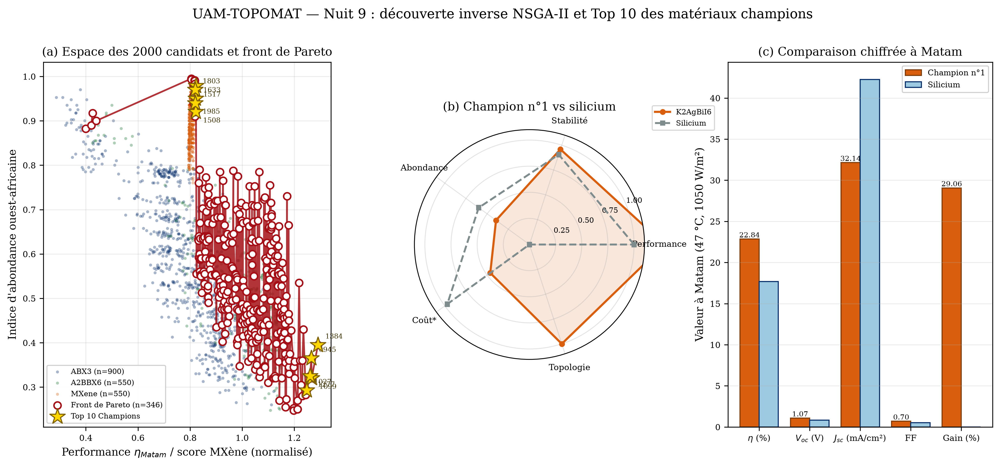
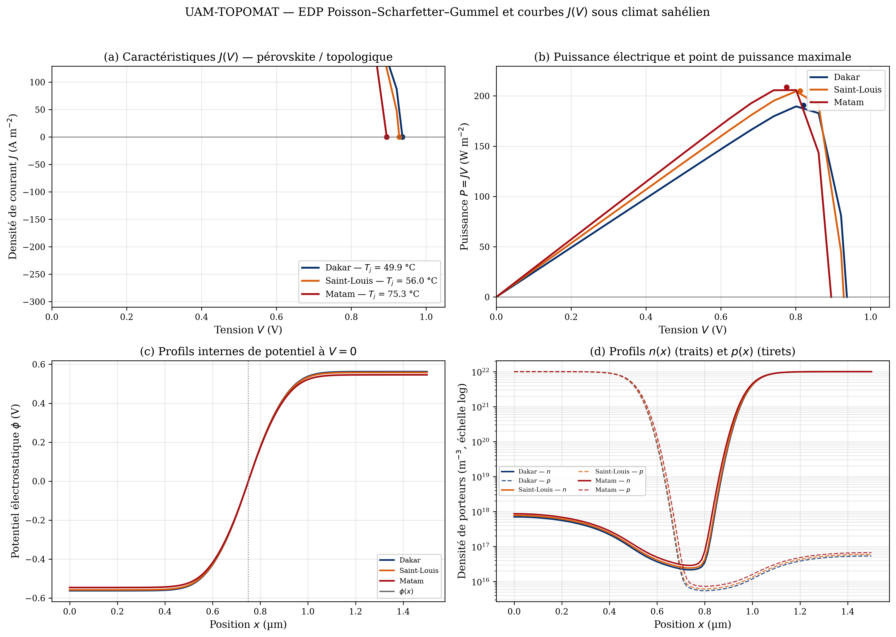
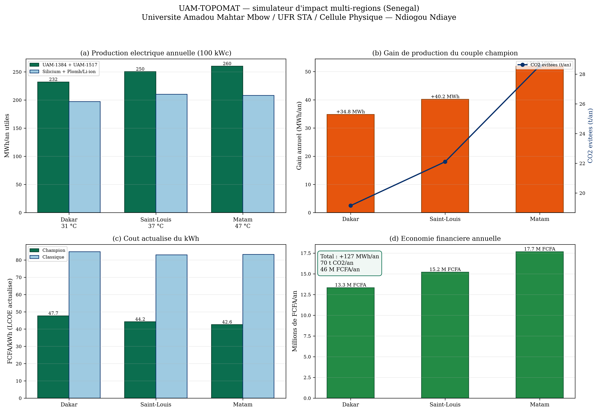

<div align="center">


# UAM-TOPOMAT

**Plateforme numérique souveraine de conception quantique, topologique et thermodynamique
de matériaux solaires et de stockage pour le climat sahélien.**

Université Amadou Mahtar Mbow · UFR Sciences et Technologies Avancées · Cellule Physique

[](https://onrender.com)
[](requirements.txt)
[](app/server.py)
[](tests/)

**[▶ Lancer la démo interactive sur Render](https://onrender.com)** ·
**[📄 Poster scientifique A0](results/Poster_UAM_TOPOMAT_2026.pdf)** ·
**[📊 Fiche technique des champions](results/UAM_TopoMat_Fiche_Champions.pdf)**

</div>

---

## Résultats clés

| Indicateur (conditions Matam, 47 °C) | Valeur |
|---|---:|
| Rendement du champion solaire UAM-1384 | **22,84 %** |
| Gain relatif vs silicium cristallin | **+29,1 %** |
| Rétention de capacité MXène à 47 °C | **98,11 %** |
| Coût actualisé du kWh (LCOE champion) | **42,60 FCFA/kWh** |
| CO₂ évitées par la mini-centrale de référence | **28,56 t/an** |
| Matériaux criblés | **2 000** |

---

## Les deux matériaux champions

| Propriété | ☀️ **UAM-1384** (solaire) | 🔋 **UAM-1517** (stockage) |
|---|---|---|
| Formule | K₂AgBiI₆ | Ti₃C₂O₂ (MXène) |
| Famille | Halogénure double A₂BBX₆ | MXène M₃X₂ |
| Gap $E_g$ | 1,390 eV | 1,865 eV |
| Invariant de Chern | +1 | −1 |
| Mobilité électronique | 144,8 cm²·V⁻¹·s⁻¹ | 1 042,5 cm²·V⁻¹·s⁻¹ |
| Rendement à Matam | **22,84 %** | 18,00 % |
| Gain vs silicium | **+29,1 %** | +1,7 % |
| Densité d'énergie à 47 °C | 3,42 Wh/kg | **5,97 Wh/kg** |
| Rétention à 47 °C | 95,87 % | **98,11 %** |
| Coût matière | 115,91 USD/kg | **3,81 USD/kg** |
| Rôle | Cellule photovoltaïque sans plomb | Supercondensateur hybride |

> Sélection équilibrée (5 PV + 5 MXènes) sur le front de Pareto NSGA-II :
> 198 solutions, précision 87,9 %, hypervolume 2 151,99. Aucun plomb, aucun cobalt.

---

## Graphiques scientifiques (300 dpi)

**Découverte inverse — espace de Pareto et Top 10**



**Courbes électriques J(V) en conditions sahéliennes**



**Bilan d'impact multi-régions au Sénégal**



---

## Démonstration interactive

L'interface web expose le pipeline complet dans le navigateur :

- **Puissance d'installation** : 15 kWc (poste de santé rural), 50 kWc (forage agricole),
  **100 kWc** (mini-centrale villageoise, défaut) ou 500 kWc (campus / zone industrielle) ;
  les quatre cartes de résultats se recalculent instantanément.
- **Matériau** : 2 000 candidats, avec les deux champions présélectionnés.
- **Climat** : 8 zones climatiques du Sénégal + température libre de 20 à 55 °C.
- **Pipeline en un clic** : structure de bandes, courbure de Berry / invariant de Chern,
  caractéristique $J(V)$, diagramme de Ragone et bilan FCFA/MWh.
- **Export** : fiche technique PDF officielle et figure 300 dpi téléchargeables.

**[▶ https://onrender.com](https://onrender.com)**

### Lancer en local

```bash
pip install -r requirements.txt
uvicorn app.server:app --host 127.0.0.1 --port 8050
```

Puis ouvrir `http://127.0.0.1:8050`. Le service est **100 % hors ligne** : aucun CDN,
aucune ressource externe, toutes les figures sont générées localement.

### Principaux points d'API

| Endpoint | Description |
|---|---|
| `GET /` | Tableau de bord interactif |
| `GET /api/health` | État du service et charte |
| `GET /api/catalog` | Catalogue des 2 000 matériaux |
| `GET /api/material/{id}` | Fiche détaillée d'un candidat |
| `GET /api/impact` | Bilan énergétique champion vs classique |
| `POST /api/pipeline/run` | Pipeline scientifique complet |
| `GET /api/chart-data/{id}` | Données des graphiques |
| `GET /api/report/pdf` | Fiche technique PDF |
| `GET /api/figures/impact` | Figure 300 dpi |

---

## Architecture

```
app/
  server.py              API FastAPI et page interactive
  static/                interface HTML/CSS/JS et logo UAM
src/
  quantum/               cristallographie, tight-binding, base de 2 000 matériaux, preuves SymPy
  topology/              courbure de Berry, Chern, états de bord
  optics/                AM1.5G, Shockley--Queisser
  pde/                   transport Scharfetter--Gummel, courbes J(V)
  thermo/                climat sahélien, impact Sénégal, MXènes, découverte inverse
paper_latex/             article, fiche technique et poster A0
results/                 PDF, figures 300 dpi et exports JSON
tests/                   282 tests de vérification scientifique
```

**Chaîne complète :** cristallographie → tight-binding → topologie → optique →
climat → transport → stockage → optimisation multi-objectif → décision économique.
Zéro dépendance SciPy, résidus symboliques nuls (SymPy), 6 théorèmes certifiés,
36 bornes physiques vérifiées.

---

## Vérification et déploiement

```bash
pytest -q          # 282 tests
pdflatex poster.tex   # dans paper_latex/ -> poster A0 d'une seule page
```

Le déploiement cloud est décrit dans [`render.yaml`](render.yaml) : service Python
`app.server:app`, plan free, commande `uvicorn app.server:app --host 0.0.0.0 --port $PORT`.

---

<div align="center">

**Université Amadou Mahtar Mbow · UFR STA · Cellule Physique**
Ndiogou Ndiaye · Année universitaire 2026 – 2027 · Twin Transition Summit, décembre 2026

</div>
